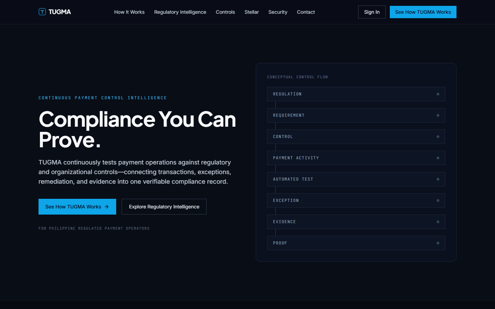
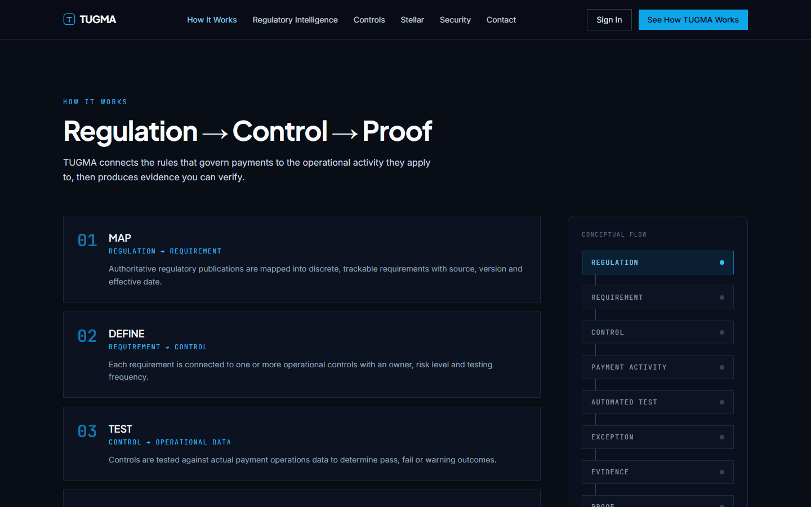
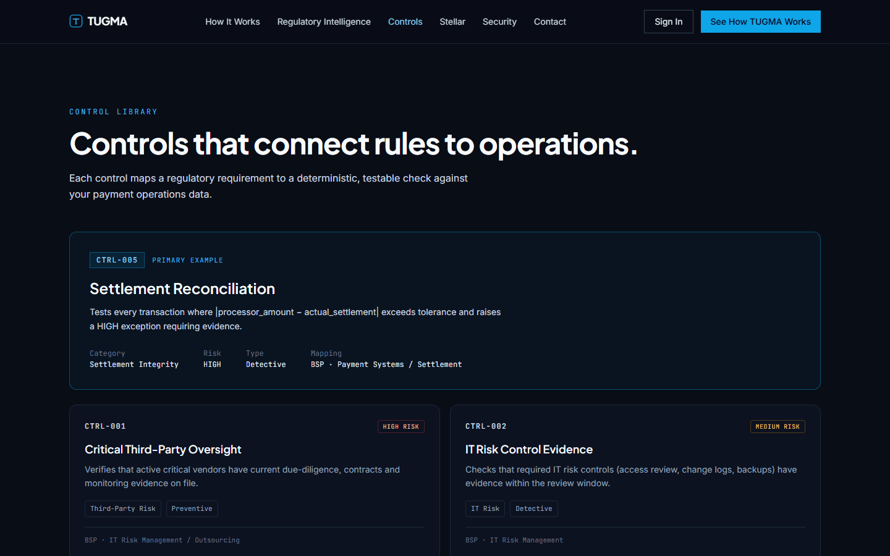
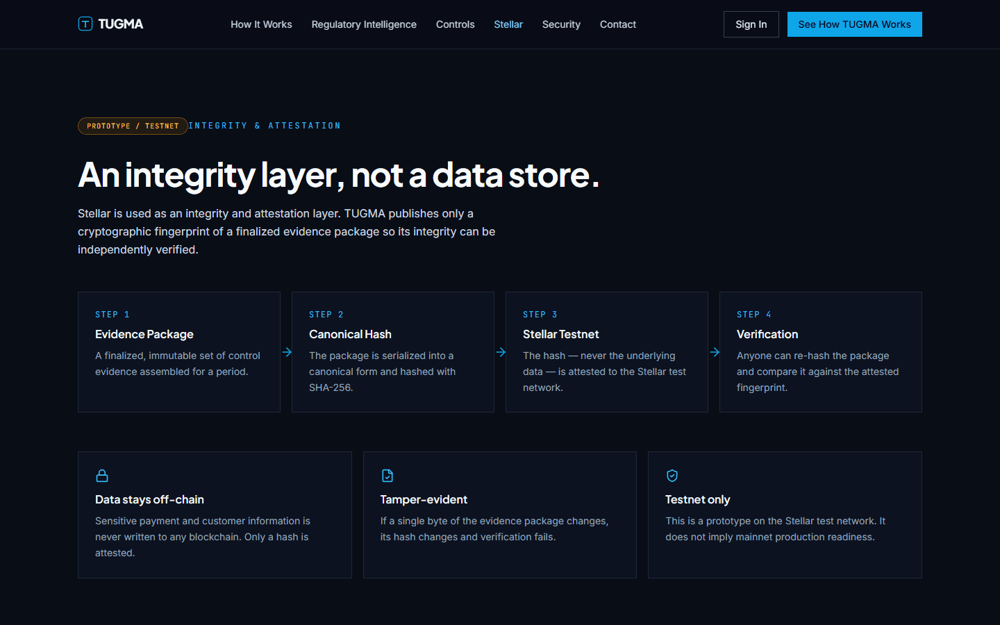
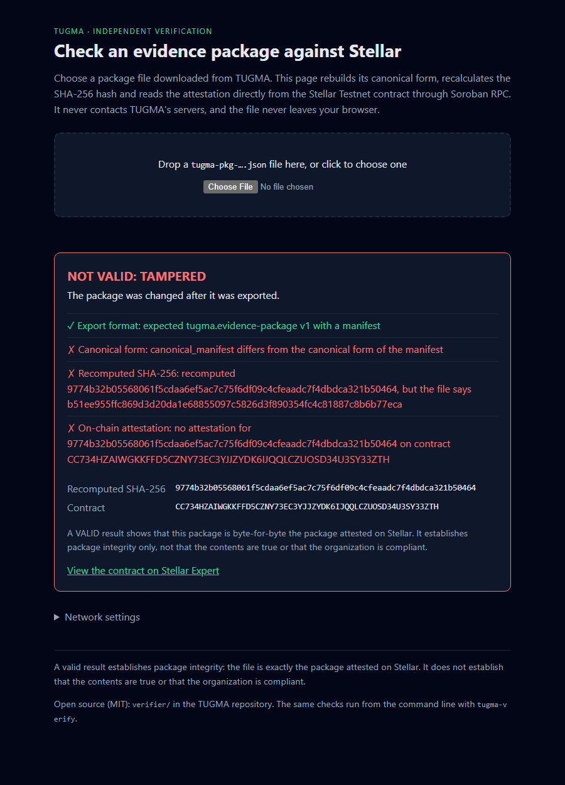
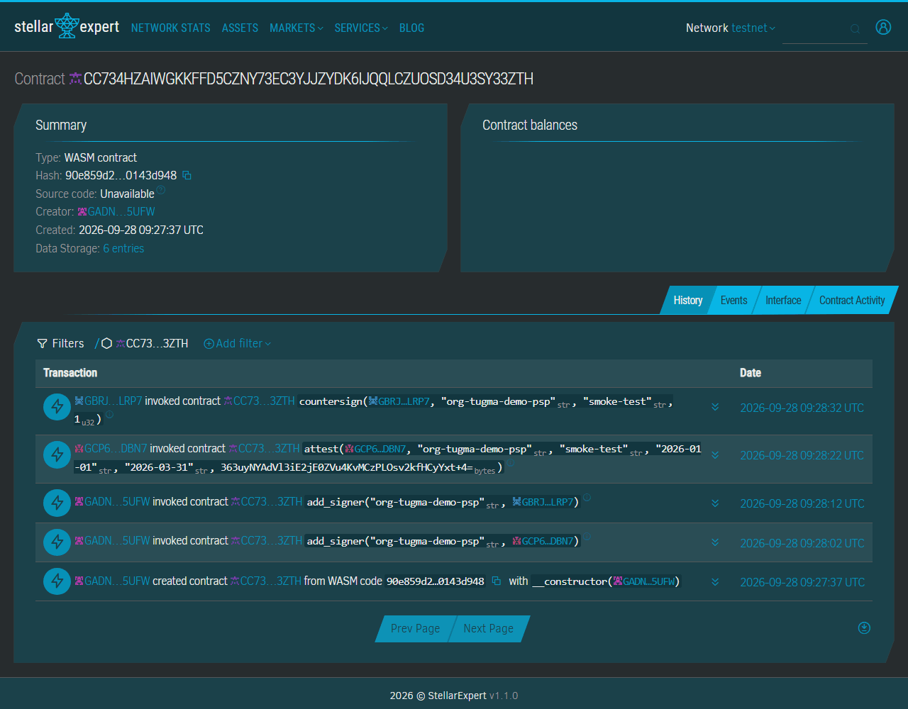
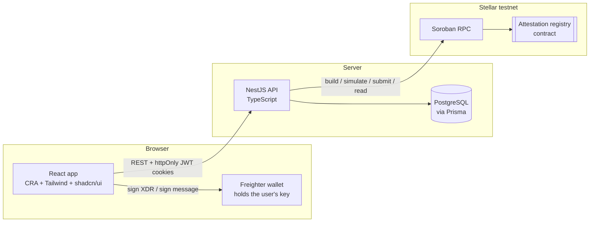
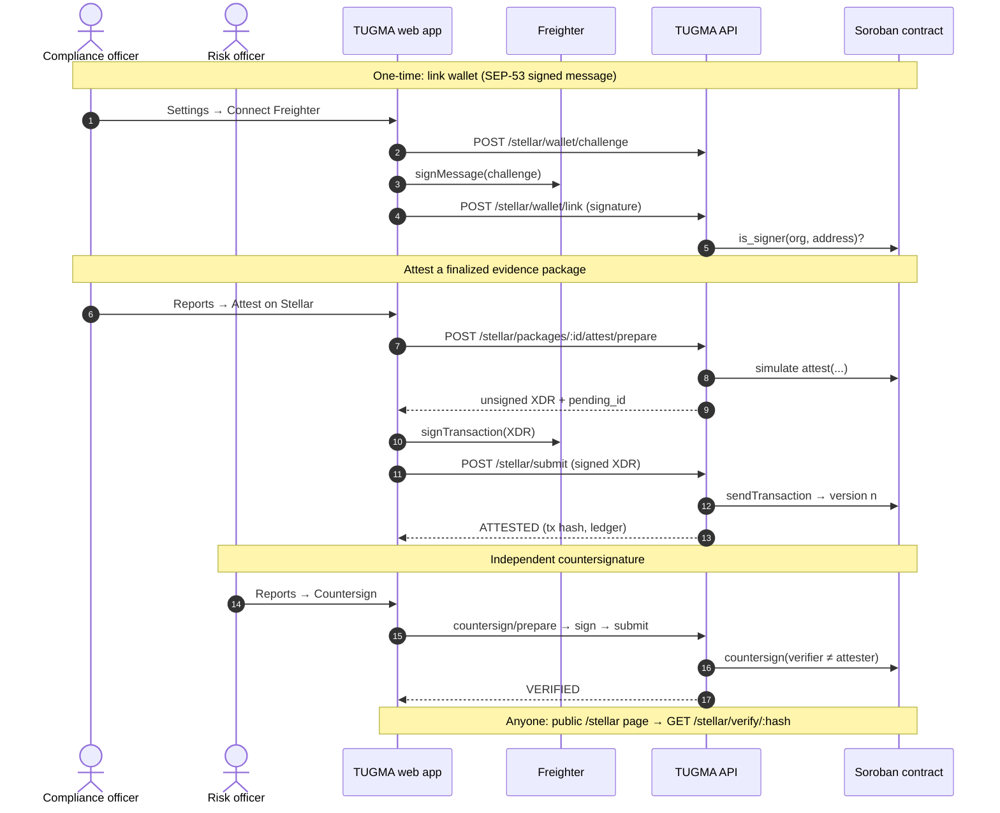

<div align="center">

# TUGMA

### Compliance You Can Prove

**Continuous payment control intelligence for regulated payment operators, with evidence packages anyone can verify on Stellar.**

[](https://github.com/christopher-icalla/tugma/actions/workflows/ci.yml)
[](LICENSE)
[](https://tugmaapp.com)
[](https://stellar.expert/explorer/testnet/contract/CC734HZAIWGKKFFD5CZNY73EC3YJJZYDK6IJQQLCZUOSD34U3SY33ZTH)
[](contracts/)
[](#deterministic-by-design-no-ai)

[**Live app**](https://tugmaapp.com) · [**Contract on Stellar Expert**](https://stellar.expert/explorer/testnet/contract/CC734HZAIWGKKFFD5CZNY73EC3YJJZYDK6IJQQLCZUOSD34U3SY33ZTH) · [**Verify a package**](https://christopher-icalla.github.io/tugma/verifier/web/) · [**What goes on-chain**](docs/onchain-footprint.md)

<a href="https://tugmaapp.com"></a>

</div>

TUGMA continuously tests actual payment operations against regulatory and organizational controls, identifies exceptions, connects them to remediation and evidence, and produces evidence packages whose integrity anyone can verify on Stellar, with an open-source verifier that never has to trust TUGMA.

> **Detect. Prevent. Prove.**

---

## Live deployments

| | |
|---|---|
| **Web app** | [tugmaapp.com](https://tugmaapp.com) |
| **Attestation contract** (Soroban, Stellar Testnet) | [`CC734HZAIWGKKFFD5CZNY73EC3YJJZYDK6IJQQLCZUOSD34U3SY33ZTH`](https://stellar.expert/explorer/testnet/contract/CC734HZAIWGKKFFD5CZNY73EC3YJJZYDK6IJQQLCZUOSD34U3SY33ZTH) |
| Explore the contract | [Stellar Expert](https://stellar.expert/explorer/testnet/contract/CC734HZAIWGKKFFD5CZNY73EC3YJJZYDK6IJQQLCZUOSD34U3SY33ZTH) · [Stellar Lab](https://lab.stellar.org/r/testnet/contract/CC734HZAIWGKKFFD5CZNY73EC3YJJZYDK6IJQQLCZUOSD34U3SY33ZTH) |
| Network | Stellar Testnet · passphrase `Test SDF Network ; September 2015` |
| Soroban RPC | `https://soroban-testnet.stellar.org` |
| **Browser verifier** (GitHub Pages) | [christopher-icalla.github.io/tugma/verifier/web](https://christopher-icalla.github.io/tugma/verifier/web/) |
| Project site (GitHub Pages) | [christopher-icalla.github.io/tugma](https://christopher-icalla.github.io/tugma/), published from [`site/`](site/) by [`jekyll-gh-pages.yml`](.github/workflows/jekyll-gh-pages.yml) |
| Command-line verifier | [`verifier/`](verifier/): `node bin/tugma-verify.js <package.json>` |
| Contract source | [`contracts/contracts/attestation/src/lib.rs`](contracts/contracts/attestation/src/lib.rs) |

---

## Screenshots

<table>
  <tr>
    <td width="50%"><a href="https://tugmaapp.com/how-it-works"></a><br><sub><b>How it works</b>: regulation to proof, one traceable chain</sub></td>
    <td width="50%"><a href="https://tugmaapp.com/controls"></a><br><sub><b>Control library</b>: deterministic, testable checks mapped to BSP and AMLC requirements</sub></td>
  </tr>
  <tr>
    <td width="50%"><a href="https://tugmaapp.com/stellar"></a><br><sub><b>Stellar</b>: an integrity layer, not a data store; public hash lookup</sub></td>
    <td width="50%"><br><sub><b>Standalone verifier</b>: a package edited after export fails, checked live against Testnet</sub></td>
  </tr>
  <tr>
    <td colspan="2"><a href="https://stellar.expert/explorer/testnet/contract/CC734HZAIWGKKFFD5CZNY73EC3YJJZYDK6IJQQLCZUOSD34U3SY33ZTH"></a><br><sub><b>The attestation contract on Stellar Expert</b>: deployment, signer authorization, attestation and countersignature on Testnet</sub></td>
  </tr>
</table>

---

## The problem

Regulated payment operators have policies, regulatory requirements, operational controls, transaction data, approvals, reconciliations, and evidence scattered across different systems and workflows.

The difficult question is not only:

> "Do we have a compliance policy?"

It is:

> **"Did the actual payment operation follow the required control, and can we prove what happened?"**

TUGMA connects the requirement to the actual payment activity and creates a traceable evidence chain.

---

## How TUGMA works

```text
REGULATION                  BSP Manual of Regulations for Payment Systems, AMLC issuances
    ↓
REQUIREMENT                 e.g. BSP-PS-04 Settlement Integrity and Reconciliation
    ↓
CONTROL                     e.g. CTRL-005 Settlement Reconciliation
    ↓
PAYMENT ACTIVITY            10,000 synthetic transactions
    ↓
AUTOMATED CONTROL TEST      PASS / FAIL / WARNING / NOT_TESTABLE per record
    ↓
EXCEPTION                   explainable: expected vs actual vs variance vs tolerance
    ↓
REMEDIATION                 owner, due date, completion note
    ↓
EVIDENCE                    content-hashed (SHA-256) records
    ↓
INDEPENDENT VERIFICATION    verifier ≠ resolver (segregation of duties)
    ↓
EVIDENCE PACKAGE            canonical manifest for a reporting period
    ↓
SHA-256 INTEGRITY PROOF     same inputs → same hash
    ↓
STELLAR ATTESTATION         hash anchored by one signer, countersigned by another
```

A worked example ships with the demo data. Transaction **TX-847291** was processed for PHP 10,000.00 but settled at PHP 9,500.00. CTRL-005 flags a PHP 500.00 variance against a 0.01 PHP tolerance, which raises exception `EXC-CTRL-005-TX-847291`. The exception then moves through review, remediation with attached evidence, and independent verification. It lands in the Q1 evidence package, and that package's hash is attested on Stellar.

---

## Features

- **Regulatory intelligence.** Official requirements are kept separate from TUGMA's interpretation and from the operational control, so each layer is traceable to its source document.
- **Deterministic control engine.** Five controls run against real transaction fields. Runs are append-only, and re-running never duplicates exceptions or resets their workflow state. Every control runs daily at `CONTROL_SCHEDULE` (Manila time, default 02:00), optionally followed by reminder emails, and the dashboard shows the last and next run.
- **Explainable exceptions.** Every failure records its check, expected value, actual value, variance and tolerance.
- **Five-state workflow.** `OPEN → IN_REVIEW → REMEDIATION → RESOLVED → VERIFIED`. An exception can't be resolved without evidence and a completed remediation, and the verifier must be a different person from the resolver.
- **Follow-ups and reminders.** The dashboard groups open exceptions by how far past their due date they are (not due, 1–7, 8–30, 30+ days) and lists attestations still waiting for a countersignature. Compliance leads can email each owner their overdue items and each eligible signer the packages to countersign (never the attesting wallet's owner), and every send is audited.
- **Evidence Center.** Every evidence record carries a SHA-256 content hash, and completeness is scored per exception and per control.
- **Evidence packages.** A canonical, sorted-key JSON manifest for a period is hashed with SHA-256. Regenerating the same period reproduces the same hash.
- **On-chain attestation (Soroban).** Users sign with their own Freighter wallet: one authorized signer attests the package hash and a different one countersigns. Versions are append-only, and anyone can look up a hash on the public `/stellar` page.
- **Independent verification.** A finalized package downloads in canonical form, and the open-source verifier (`verifier/`, command line and browser) rebuilds its canonical JSON, recalculates the SHA-256 and reads the attestation straight from the Testnet contract through Soroban RPC, without calling TUGMA's API. A match proves package integrity, not that the contents are true. See [docs/verify-a-package.md](docs/verify-a-package.md).
- **Verifier toolkit.** `tugma-verify batch` checks a folder of packages at once (also in the browser by choosing several files), `diff` shows what changed between two package versions, and `signers` audits who attested and countersigned every version and whether those wallets are still authorized.
- **Two-party attestation (optional, Testnet only).** A dedicated attestation account whose signers and thresholds (`setOptions`) need both TUGMA's key and an independent reviewer's key. TUGMA builds and signs the attestation on its server, the reviewer signs it in their own wallet through Stellar Wallets Kit, and the verifier shows both signers. Off unless configured; see [docs/two-party-attestation.md](docs/two-party-attestation.md).
- **Signed exports.** A user's linked Freighter wallet can sign the exported file (SEP-53), so a verifier also sees which account exported this exact package.
- **Version history.** The verifier lists every attested version of a package and marks the one the file matches.
- **Per-document proofs.** One evidence record can be checked against its line in a package, without sharing any other document.
- **Verify links and QR codes.** The public `/stellar` page links to the verifier, and every finalized package carries a QR code with its id and SHA-256 for printed audit reports.
- **Audit report (PDF).** One click opens a print-ready, regulator-style report for a finalized package: integrity proof with QR code, attestation and countersignature transactions, summary, control results, the exceptions and an evidence index that flags any record changed since the package. The browser saves it as PDF.
- **Package timeline.** Each package shows when it was generated, attested and countersigned on Stellar (with ledger and transaction links), downloaded and synced, and by whom.
- **Append-only audit trail.** Every write is logged, and no route exists to edit or delete audit entries.
- **Role-based access control.** Seven roles, enforced on the server and mirrored in the UI.

---

## Architecture



The API **never holds a Stellar secret key**. It builds and simulates every contract call, hands the unsigned transaction to the browser, and Freighter signs it. The API then checks that the signed envelope is byte-for-byte the transaction it prepared, submits it, and records the confirmed result.

The one exception is the optional [two-party attestation](docs/two-party-attestation.md) mode, off unless its `MULTISIG_*` settings are configured: TUGMA's server key and an independent reviewer's wallet key are the two signers of a Testnet attestation account that needs both, so TUGMA's key can't attest anything on its own and never sees the reviewer's key.

---

## On-chain attestation flow



Segregation of duties is enforced **twice**. The API rejects a countersignature from the user who attested, and the contract rejects one from the attesting wallet (`SelfVerification`).

---

## Verify a package yourself

Anyone holding a package file can check it against Stellar without TUGMA. Download it from **Reports → Download canonical package**, then:

```sh
cd verifier && corepack enable && pnpm install --frozen-lockfile
node bin/tugma-verify.js tugma-pkg-2026-01-01-2026-03-31.json
```

Example output for an attested, countersigned package (abridged):

```text
VALID: this package is the one attested on Stellar.

  [ok]   Export format: expected tugma.evidence-package v1 with a manifest
  [ok]   Canonical form: canonical_manifest matches the manifest
  [ok]   Recomputed SHA-256: matches the exported hash b51ee955ffc8…
  [ok]   On-chain attestation: version 1 attested in ledger …
  [ok]   Package, organization and period: pkg-2026-01-01-2026-03-31 for org_…

  Versions on-chain (newest first):
    => v1  b51ee955ffc869d3…  2026-…  countersigned  (this file)
```

| Result | Meaning |
|---|---|
| `VALID` | The file is byte-for-byte the package attested on Stellar |
| `TAMPERED` | The contents changed after export |
| `NOT_ATTESTED` | No attestation exists for the recomputed hash |
| `MISMATCH` | The attestation is for a different package, organization or period |
| `BAD_SIGNATURE` | A signed export whose SEP-53 signature does not check out |

The same checks run in the browser, hosted at [christopher-icalla.github.io/tugma/verifier/web](https://christopher-icalla.github.io/tugma/verifier/web/) or locally with `pnpm web`, and `pnpm demo` shows a valid package passing and a modified one failing. One evidence record can be checked on its own with `tugma-verify evidence <record.json> --package <package.json>`. Full guide: [docs/verify-a-package.md](docs/verify-a-package.md).

> A `VALID` result establishes **package integrity**, not that the contents are true or that the organization is compliant.

---

## Tech stack

| Layer | Technology |
|---|---|
| Frontend | React 19, Create React App + CRACO, Tailwind CSS, shadcn/ui (Radix), lucide-react, sonner |
| Wallet | [Freighter](https://www.freighter.app/) via `@stellar/freighter-api` |
| Backend | NestJS 11, TypeScript 5, Express, Zod validation |
| Database | PostgreSQL 16 (14+ works), Prisma ORM and migrations |
| Auth | bcrypt password hashes, HS256 JWT access (15 min) and refresh (7 days) tokens in httpOnly cookies, token-version revocation, login lockout |
| Blockchain | Stellar Soroban smart contract in Rust (`soroban-sdk`), `@stellar/stellar-sdk` for RPC |
| Testing | Jest + Supertest (API e2e against Postgres), Rust unit tests for the contract |
| CI / Ops | GitHub Actions, Docker, Docker Compose |

---

## Repository layout

```text
.
├── backend/                     NestJS API
│   ├── prisma/                  schema.prisma + SQL migrations
│   ├── src/
│   │   ├── auth/                login, refresh, password reset, RBAC guard, permission matrix
│   │   ├── api/                 dashboard, controls, transactions, exceptions, evidence, packages
│   │   ├── engine/              deterministic control engine
│   │   ├── seed/                reference data + reproducible 10k-transaction generator
│   │   ├── stellar/             Soroban client + attestation workflow (prepare / submit / sync / verify)
│   │   └── main.ts
│   ├── test/                    e2e suite + in-memory contract stand-in
│   └── Dockerfile
├── frontend/                    React app (public site + authenticated control center)
│   └── src/
│       ├── lib/stellar.js       Freighter helpers (link wallet, sign & submit)
│       ├── components/app/      AttestationPanel, StellarWallet, package download and QR, shared UI
│       └── pages/               public/, auth/, app/
├── contracts/                   Soroban attestation registry (Rust)
├── verifier/                    standalone package verifier: CLI, browser page, shared test vectors
├── docs/                        on-chain footprint, verifying a package, README images
├── site/                        GitHub Pages landing page
├── memory/PRD.md                product requirements
├── docker-compose.yml           Postgres + API
└── .github/workflows/          ci.yml (all pipelines), jekyll-gh-pages.yml (GitHub Pages site and hosted verifier)
```

---

## Getting started

### Prerequisites

- Node.js **22.12+**
- PostgreSQL **14+** (or Docker)
- pnpm through Corepack (`corepack enable`); each package pins its pnpm version in `packageManager`
- Rust + `wasm32v1-none` target and the [Stellar CLI](https://developers.stellar.org/docs/tools/cli), only if you're building or deploying the contract
- [Freighter](https://www.freighter.app/), only if you're signing attestations

### 1. Configure the API

```sh
cp backend/.env.example backend/.env
# Set JWT_SECRET, ADMIN_EMAIL, ADMIN_PASSWORD, DEMO_USER_PASSWORD (and DATABASE_URL if not using Docker)
```

### 2a. Run with Docker Compose

```sh
POSTGRES_PASSWORD=$(openssl rand -hex 16) docker compose up --build   # Postgres + API on 127.0.0.1
```

### 2b. …or run the API directly

```sh
cd backend
corepack enable
pnpm install
pnpm exec prisma migrate deploy   # create tables
pnpm start:dev                    # http://localhost:8001 (watch mode)
```

On first boot the API seeds the organization, the regulatory sources, the controls and the users, generates the 10,000-transaction dataset, and runs the control engine. Every step is idempotent, so restarting is safe.

### 3. Run the web app

```sh
cd frontend
corepack enable
pnpm install
echo "REACT_APP_BACKEND_URL=http://localhost:8001" > .env
pnpm start                        # http://localhost:3000
```

### Configuration, roles and API

- **Configuration:** every API setting is an environment variable, validated at startup and documented in [`backend/.env.example`](backend/.env.example). The API refuses to start on anything but Stellar Testnet.
- **Roles:** seven roles (ADMIN, COMPLIANCE, RISK, PAYMENT_OPS, FINANCE, AUDITOR, VIEWER), enforced on the server in [`backend/src/auth/permissions.ts`](backend/src/auth/permissions.ts).
- **API:** REST under `/api`, defined in [`backend/src/api`](backend/src/api) and [`backend/src/stellar`](backend/src/stellar). Public routes: `/health`, `/stellar/config` and `/stellar/verify/:hash`.

### Demo accounts

| Email | Role | Password |
|---|---|---|
| `ADMIN_EMAIL` from `.env` | ADMIN | `ADMIN_PASSWORD` |
| `compliance@tugmademo.ph` | COMPLIANCE | `DEMO_USER_PASSWORD` |
| `risk@tugmademo.ph` | RISK | `DEMO_USER_PASSWORD` |
| `ops@tugmademo.ph` | PAYMENT_OPS | `DEMO_USER_PASSWORD` |
| `finance@tugmademo.ph` | FINANCE | `DEMO_USER_PASSWORD` |
| `auditor@tugmademo.ph` | AUDITOR | `DEMO_USER_PASSWORD` |
| `viewer@tugmademo.ph` | VIEWER | `DEMO_USER_PASSWORD` |

---

## Setting up Stellar signing

The API defaults to the TUGMA registry already deployed on testnet:

| | |
|---|---|
| Contract ID | `CC734HZAIWGKKFFD5CZNY73EC3YJJZYDK6IJQQLCZUOSD34U3SY33ZTH` |
| Network | Stellar Testnet |
| Organization key | Opaque on-chain id (`org_` + 32 hex), shown under **Settings → Stellar Signers**. The readable organization id is never sent on-chain. |
| Explorer | [stellar.expert](https://stellar.expert/explorer/testnet/contract/CC734HZAIWGKKFFD5CZNY73EC3YJJZYDK6IJQQLCZUOSD34U3SY33ZTH) · [Stellar Lab](https://lab.stellar.org/r/testnet/contract/CC734HZAIWGKKFFD5CZNY73EC3YJJZYDK6IJQQLCZUOSD34U3SY33ZTH) |

To attest from the app:

1. **Install Freighter** and switch it to **Testnet**.
2. **Fund the account** with Friendbot: `https://friendbot.stellar.org?addr=<G...>`.
3. **Link the wallet.** Sign in as a COMPLIANCE, RISK or ADMIN user, open **Settings → Stellar Wallet → Connect Freighter**, and approve the one-time message signature.
4. **Authorize it on-chain.** The contract admin runs:

   ```sh
   stellar contract invoke --id CC734HZAIWGKKFFD5CZNY73EC3YJJZYDK6IJQQLCZUOSD34U3SY33ZTH \
     --source tugma-admin --network testnet -- \
     add_signer --org <opaque on-chain org id> --signer <G... address>
   ```

   **Settings → Stellar Signers** shows this command with the id and every pending wallet filled in. Settings shows **Authorized signer on-chain** once this is done.
5. **Attest.** On **Reports**, generate a package for a period, then click **Attest on Stellar** and approve in Freighter.
6. **Countersign.** Sign in as a *different* authorized user (for example, RISK attests and COMPLIANCE countersigns) and click **Countersign**.
7. **Verify.** Anyone can paste the package hash on the public **/stellar** page.

If a package is regenerated after new evidence arrives, its hash changes. Reports then shows the attestation as stale and offers **Re-attest new hash**, which appends version *n+1*; earlier versions remain on-chain. **Sync from chain** rebuilds local records from contract state, which covers attestations made with the CLI. It keeps each version's Stellar transaction hash, and recovers a missing one from the contract's `attested` event through the Soroban RPC.

Exactly what is public on Stellar, and what stays off-chain, is listed field by field in [`docs/onchain-footprint.md`](docs/onchain-footprint.md).

Contract build, test and deploy instructions are in [`contracts/README.md`](contracts/README.md). To use your own deployment, set `STELLAR_CONTRACT_ID`.

---

## Controls and the demo dataset

| Code | Control | Requirement | Logic | Latest result |
|---|---|---|---|---|
| CTRL-001 | Critical Third-Party Oversight | BSP-ITRM-01 | Critical vendors must have `CURRENT` due diligence | 1 warning (4 vendors) |
| CTRL-002 | IT Risk Control Evidence | BSP-ITRM-02 | Approval recorded; initiator ≠ approver | 30 fail |
| CTRL-003 | AML/CTPF Control Evidence | AMLC-CTF-01 | Amount > PHP 500,000 needs a CTR; same-day splits for one merchant, each 450,000–500,000 and together above 500,000, are possible structuring | 4 warnings, 6 fail |
| CTRL-004 | Merchant / End-User Protection | BSP-EUP-01 | Supporting evidence per transaction | 10 warnings |
| CTRL-005 | Settlement Reconciliation | BSP-PS-04 | Settlement and payout variance > 0.01 PHP; duplicate idempotency keys | 82 fail, 150 not testable |

The dataset is **synthetic and reproducible**. It has 10,000 transactions across 150 merchants, generated from a fixed seed, with an exact set of injected defects: 60 settlement discrepancies, 7 payout breaches, 15 duplicates, 25 missing approvals, 5 segregation-of-duty breaches, 10 missing-evidence cases, 4 covered transactions above PHP 500,000, 2 structuring patterns of 3 same-day transactions just below the threshold, and 150 unsettled transactions. The engine *detects* these defects from the transaction fields; it never reads them back as answers. The result is **132 exceptions, 78 of them high severity**.

---

## Testing and CI

```sh
# API: needs a Postgres database whose name contains "test" (it is cleared before the run)
cd backend
TEST_DATABASE_URL=postgresql://localhost:5432/tugma_test pnpm test

# Contract
cd contracts && cargo test

# Web app
cd frontend && CI=true pnpm build

# Standalone verifier (no database or network needed)
cd verifier && pnpm install --frozen-lockfile && pnpm test
```

The API e2e suite boots the full NestJS app against Postgres. It checks the engine numbers, the exception workflow, the 403 role gates, package hash reproducibility, and the complete **link → attest → countersign → verify → sync** flow. That flow runs against an in-memory stand-in for the contract that enforces the contract's own rules, so CI doesn't depend on testnet. The same flow has been run end to end against real Stellar testnet.

[GitHub Actions](.github/workflows/ci.yml) runs these jobs on every push and pull request: **backend** (typecheck, tests against a Postgres service, build), **verifier** (`pnpm test`, including the offline valid-vs-tampered demo), **frontend** (production build with lint warnings as errors), **contracts** (`cargo test` plus a wasm build uploaded as an artifact), the API Docker image build, and the no-AI policy check.

---

## Deterministic by design: no AI

TUGMA uses **no AI, LLM or machine-learning model** in its compliance or attestation workflow. Control tests, regulatory mapping, exception explanations, evidence hashing, attestation and verification are deterministic code, because an integrity proof only means something if the data behind it can be reproduced byte for byte. [`scripts/check-no-ai.mjs`](scripts/check-no-ai.mjs) enforces this in CI: it fails the build if an AI/ML library appears in any dependency tree or if source code calls a hosted AI API.

---

## Security model

- **No custodial keys.** Stellar secrets live only in users' wallets. The API prepares transactions and verifies that the signed envelope hash matches what it prepared, so a client can't swap in a different call.
- **Wallet ownership is proven** with a SEP-53 signed challenge that expires after 5 minutes. A Stellar account can be linked to only one user.
- **Data stays off-chain.** Only the 32-byte SHA-256 of a package manifest goes on-chain.
- **Sessions** use httpOnly, Secure, `SameSite=Lax` cookies. Changing a password increments `token_version`, which revokes existing sessions. Five failed logins lock an IP+email pair for 15 minutes, and login takes the same time whether or not the email exists.
- **CSRF**: besides SameSite cookies, the API rejects state-changing requests whose `Origin` isn't the web app, and it accepts JSON bodies only (≤ 100 KB), so HTML forms on other sites can't post to it.
- **Rate limits** (per IP): 300 requests/min overall; 10/min on login, refresh and password reset; 20/min on wallet linking and transaction building; 30/min on the public hash lookup.
- **Headers**: helmet sets HSTS, `nosniff`, frame protection and related headers; `X-Powered-By` is removed. Errors never include stack traces.
- **Secrets**: the API won't start with placeholder or previously leaked passwords, or a JWT secret shorter than 32 characters.
- **Password reset** returns the same response whether or not the email exists, and its tokens are single-use, expire after one hour, and are stored only as hashes.
- **The audit trail is append-only**, with no update or delete routes.
- **Money** is stored as `NUMERIC(14,2)` and compared with decimal arithmetic.

---

## Disclaimer

TUGMA provides regulatory intelligence and control-mapping software. It does not provide legal advice, certify compliance, or represent that an organization is approved or certified by any government authority. TUGMA is not an AML transaction-monitoring replacement, a payment processor, a bank, or a regulator. All data in this repository is synthetic demonstration data. The Stellar integration runs on **testnet** and does not imply mainnet production readiness.

---

## License

[MIT](LICENSE) © 2026 Christopher Icalla
