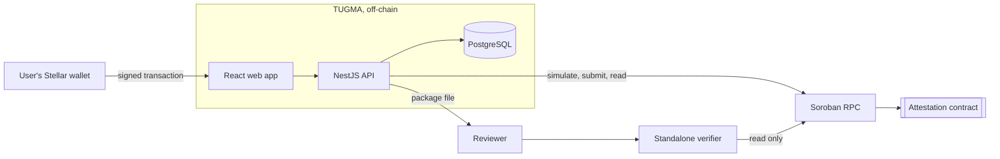

# Architecture

## Components

| Component | Source | Responsibility |
|---|---|---|
| Web app | `frontend/` | Screens, wallet signing, downloads |
| API | `backend/src/` | Sessions, roles, controls, exceptions, evidence, packages, audit log |
| Control engine | `backend/src/engine/` | Five deterministic controls; append-only runs |
| Stellar client | `backend/src/stellar/` | Builds and simulates calls, checks signed envelopes, submits, re-syncs |
| Contract | `contracts/` | Signer list, attestations, countersignatures |
| Verifier | `verifier/` | Recomputes hashes and reads the contract; CLI and static web page |

## Data flow

1. A control run tests transaction fields and raises exceptions.
2. An exception moves `OPEN → IN_REVIEW → REMEDIATION → RESOLVED → VERIFIED`. Resolving needs evidence and a completed remediation; verifying needs a different user.
3. A package collects ids and evidence hashes for a period; its canonical manifest is hashed with SHA-256 ([specification](specification.md)).
4. The API prepares `attest`; the user's wallet signs it; the API checks the signed envelope is the one it prepared, then submits it. A second user's wallet countersigns.
5. The API stores the transaction hash and ledger. Re-sync keeps them, or recovers them from the contract event while the RPC retains it.
6. A reviewer gets the package file and runs the verifier, which reads the contract through Soroban RPC and does not call TUGMA's API.

## Trust boundaries

| Boundary | Protection | Remaining trust |
|---|---|---|
| Browser to API | httpOnly cookies, origin check, server-side roles, rate limits | TUGMA operates the API and database |
| Wallet to API | API holds no user key; envelope hash must match | The user reads what the wallet shows |
| API to contract | Contract enforces signers and separate wallets | The contract admin |
| Package to verifier | Hash recomputed; contract id from the verifier's settings | The reviewer has the correct contract id and verifier source |
| Verifier to Stellar | TLS to Soroban RPC; provider can be changed | The chosen RPC answers honestly; the verifier does not check ledger proofs |
| Hosted page | Pinned SDK with integrity hash, restrictive CSP | GitHub Pages serves the committed files; use the CLI to avoid this |

## Failure behavior

| Failure | Result |
|---|---|
| TUGMA API down | Verification of a downloaded file still works; new exports and attestations do not |
| Soroban RPC down | Verifier exits 3 without a verdict; API returns 502 |
| Horizon down | Single-wallet checks are unaffected; two-party signer details are unavailable |
| RPC event retention passed | Stored transaction hashes remain; lost ones cannot be recovered from events |
| TUGMA database lost | On-chain hashes remain; packages verify only where a copy of the file exists |

Off by default: [two-party attestation](two-party-attestation.md), where the API holds one of two required keys.
